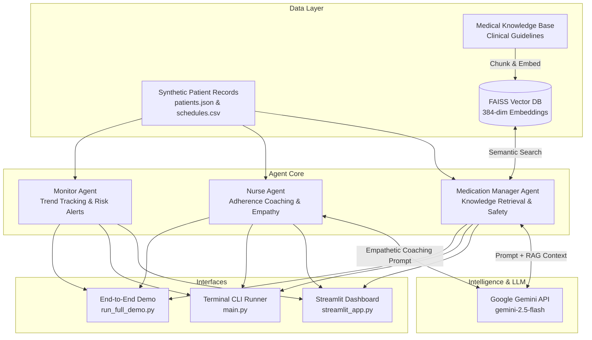

# 🏥 Medi-AI-Agent: Agentic AI Medication Management System

<p align="center">
  
  
  
  
  
  
</p>

<p align="center">
  <strong>An intelligent multi-agent AI system for personalized medication management, clinical drug interaction detection, adherence trend monitoring, and compassionate patient coaching powered by RAG and Google Gemini.</strong>
</p>

---

## 📌 Table of Contents

- [Overview](#-overview)
- [Key Features](#-key-features)
- [Multi-Agent Architecture](#-multi-agent-architecture)
- [Tech Stack](#-tech-stack)
- [Project Structure](#-project-structure)
- [Getting Started](#-getting-started)
  - [Prerequisites](#prerequisites)
  - [Installation](#installation)
  - [Environment Setup](#environment-setup)
- [Usage](#-usage)
  - [1. Interactive Web Dashboard](#1-interactive-web-dashboard-recommended)
  - [2. Multi-Agent System Demo](#2-multi-agent-system-demo)
  - [3. CLI Patient Clinical Check](#3-cli-patient-clinical-check)
  - [4. Interactive CLI Mode](#4-interactive-cli-mode)
- [How It Works](#-how-it-works)
- [Future Roadmap](#-future-roadmap)
- [Contributing](#-contributing)
- [License](#-license)

---

## 📖 Overview

Medication non-adherence and unmonitored drug-drug interactions lead to hundreds of thousands of avoidable hospitalizations annually. **Medi-AI-Agent** bridges the gap between complex pharmacological guidelines and daily patient life through a coordinated team of specialized AI agents.

By combining **Retrieval-Augmented Generation (RAG)** over clinical guidelines with algorithmic trend monitoring and generative empathy, Medi-AI-Agent provides:
- Instant detection of contraindicated medication pairs and food-drug interactions.
- Time-of-day behavioral pattern analysis to pinpoint when and why doses are missed.
- Tailored, non-judgmental coaching and reminders that adapt to patient schedules.
- An intuitive clinical dashboard designed for patients, caregivers, and clinicians.

---

## ✨ Key Features

### 🤖 Multi-Agent Orchestration
Three specialized, cooperating agents handle distinct aspects of patient care:
*   **💊 Medication Manager Agent (`src/agents/medication_manager.py`)**:
    *   Answers medication queries with cited clinical knowledge.
    *   Detects adverse interactions (e.g., Lisinopril + NSAIDs, Metformin + Alcohol).
    *   Evaluates patient conditions and allergies before generating recommendations.
*   **👩‍⚕️ Nurse Agent (`src/agents/nurse_agent.py`)**:
    *   Analyzes behavioral adherence patterns (morning vs. afternoon vs. evening lapses).
    *   Delivers warm, empathetic coaching messages using positive reinforcement.
    *   Formulates personalized daily reminders and habit-linking strategies.
*   **📈 Monitor Agent (`src/agents/monitor_agent.py`)**:
    *   Tracks longitudinal adherence trends (`declining`, `improving`, `stable`).
    *   Triggers early warning alerts for critical non-adherence (<50%) and consecutive missed doses.
    *   Generates prioritized clinical action recommendations.

### 🔍 Grounded RAG Pipeline
*   **FAISS Vector Store**: Fast vector similarity search with normalized embeddings.
*   **Dual-Backend Embedding Generator**: Uses `sentence-transformers/all-MiniLM-L6-v2` with an intelligent, deterministic offline hashing fallback.
*   **Context Grounding**: Every medical recommendation references indexed clinical knowledge, preventing hallucinations.

### 🖥️ Interactive Web Dashboard
*   Built with **Streamlit** for real-time patient roster navigation.
*   Tabbed interface featuring:
    1.  **Patient Overview**: Chronic conditions, active medications, and calculated adherence.
    2.  **Drug Interaction Review**: Severity-graded interaction alerts and recommended clinical actions.
    3.  **Patient Education**: RAG-grounded medication guidance and precautionary warnings.
    4.  **Adherence Insights**: Visual logs of missed doses, trend indicators, and nurse coaching strategies.
    5.  **Interactive Q&A**: Real-time natural language query interface for patient questions.

---

## 🏛️ Multi-Agent Architecture



---

## 🛠️ Tech Stack

| Layer | Technologies |
| :--- | :--- |
| **LLM & Inference** | Google Gemini (`gemini-2.5-flash`), `google-generativeai` |
| **Agent Orchestration** | LangChain Core, Custom LangChain Gemini Compatibility Shim |
| **Vector Database & RAG** | FAISS (`faiss-cpu`), Sentence-Transformers (`all-MiniLM-L6-v2`) |
| **Frontend Dashboard** | Streamlit, Altair |
| **Data & Simulation** | Pandas, NumPy, Pydantic, Faker |
| **Runtime & Language** | Python 3.10 – 3.13 |

---

## 📂 Project Structure

```
Medi_AI_Agent/
├── data/
│   ├── synthetic_patients/        # Patient profiles and medication logs
│   │   ├── patients.json          # 100 realistic patient profiles
│   │   ├── summary.json           # Demographic and cohort statistics
│   │   └── medication_schedules.csv
│   └── vector_db/                 # FAISS vector store & document metadata
│       ├── index.faiss
│       └── documents.pkl
├── src/
│   ├── agents/                    # Multi-agent implementations
│   │   ├── medication_manager.py  # Drug queries & interaction specialist
│   │   ├── nurse_agent.py         # Empathetic coaching & reminders
│   │   └── monitor_agent.py       # Algorithmic adherence & risk warnings
│   ├── rag/                       # RAG Pipeline components
│   │   ├── embeddings.py          # SentenceTransformer & normalized embeddings
│   │   ├── retriever.py           # Top-k vector retrieval with threshold fallbacks
│   │   └── vector_store.py        # FAISS index wrapper
│   └── utils/
│       ├── config.py              # Centralized paths and hyperparameters
│       └── logger.py              # Standardized application logging
├── scripts/
│   ├── generate_data.py           # Synthetic patient & schedule generator
│   ├── replace_patient_names.py   # Cohort personalization utility
│   └── setup_rag.py               # RAG indexing & validation script
├── langchain_google_genai.py      # Resilient, rate-limited Gemini adapter
├── main.py                        # Primary CLI application (interactive & check modes)
├── run_full_demo.py               # Automated multi-patient demonstration script
├── streamlit_app.py               # Full-featured Streamlit web application
├── requirements.txt               # Project dependencies
├── .env.example                   # Environment configuration template
├── ARCHITECTURE.md                # Detailed technical architectural documentation
└── README.md                      # Project documentation
```

---

## 🚀 Getting Started

### Prerequisites

- **Python 3.10 or higher** (Tested up to Python 3.13)
- **Git**
- A **Google Gemini API Key** (Get one for free at [Google AI Studio](https://aistudio.google.com/))

### Installation

1. **Clone the repository:**
   ```bash
   git clone https://github.com/KaustavSaha05/Med-AI-Agent.git
   cd Med-AI-Agent
   ```

2. **Create and activate a virtual environment:**
   ```bash
   # Windows (PowerShell)
   python -m venv venv
   .\venv\Scripts\Activate.ps1

   # macOS / Linux
   python3 -m venv venv
   source venv/bin/activate
   ```

3. **Install dependencies:**
   ```bash
   pip install -r requirements.txt
   ```

### Environment Setup

1. **Create your `.env` file:**
   ```bash
   # Windows
   copy .env.example .env

   # macOS / Linux
   cp .env.example .env
   ```

2. **Add your Gemini API Key in `.env`:**
   ```env
   GOOGLE_API_KEY=your_actual_gemini_api_key_here
   DEBUG=True
   LOG_LEVEL=INFO
   ```

3. **(Optional) Index the RAG Knowledge Base:**
   *(The repository comes with a pre-indexed vector store; run this to regenerate it with new guidelines)*
   ```bash
   python scripts/setup_rag.py
   ```

---

## 💻 Usage

### 1. Interactive Web Dashboard (Recommended)

Launch the Streamlit clinical dashboard:
```bash
streamlit run streamlit_app.py
```
Open your browser at **`http://localhost:8501`** to explore patient records, inspect drug interaction flags, and ask real-time medication questions.

---

### 2. Multi-Agent System Demo

Run the automated demonstration evaluating multiple patient cohorts:
```bash
python run_full_demo.py
```
*Output preview:*
```text
======================================================================
  AGENTIC AI MEDICATION MANAGEMENT SYSTEM - FULL DEMO
======================================================================
👤 PATIENT PROFILE: Aritra Chowdhury (P0001)
   Age: 21 | Conditions: Asthma, Anxiety
   Medications: Montelukast, Buspirone
📊 ADHERENCE RATE: 33.9%

💊 DRUG INTERACTION CHECK (Monitor Agent)
   ✅ No known drug interactions detected

🤖 MEDICATION INFORMATION (Medication Manager + RAG)
   Q: What are the key things I should know about Montelukast?
   A: Montelukast is primarily used to prevent asthma attacks...

💬 ADHERENCE COACHING (Nurse Agent)
   Pattern: Most doses missed in the afternoon
   "Hi Aritra! Taking medications consistently can be tricky, especially in the afternoon. 
   Let's try linking your dose to your afternoon coffee break..."
```

---

### 3. CLI Patient Clinical Check

Run a structured comprehensive check for an individual patient ID:
```bash
python main.py --mode check --patient P0001
```

---

### 4. Interactive CLI Mode

Launch an interactive terminal command center:
```bash
python main.py --mode interactive
```
Available CLI commands:
- `check <patient_id>` — Run comprehensive multi-agent assessment.
- `ask <question>` — Ask an open-ended medication query.
- `remind <medication>` — Generate an empathetic reminder.
- `list` — View available patient IDs and diagnoses.
- `quit` — Exit the system.

---

## 🔬 How It Works

1. **Patient Context Ingestion**: Patient profiles, chronic conditions, and dose timestamps are retrieved from `data/synthetic_patients/`.
2. **Deterministic Trend Analysis**: The `MonitorAgent` analyzes timestamp histories without LLM overhead, calculating moving adherence windows and flagging critical streaks (e.g., 3 consecutive missed doses).
3. **Semantic RAG Retrieval**: When a clinical question or medication verification is triggered, the `MedicationManagerAgent` converts the query into a normalized vector, querying FAISS for top-k relevant clinical guidelines.
4. **Agent Synthesis**: Relevant guidelines, interaction matrices, and patient context are formatted into structured prompts. Google Gemini (`gemini-2.5-flash`) synthesizes accurate medical responses with source citations.
5. **Empathetic Coaching Formulation**: The `NurseAgent` assesses the timing of missed doses (e.g., morning vs. afternoon) and generates habit-stacking strategies tailored to the patient's lifestyle.

---

## 🗺️ Future Roadmap

- [ ] **Direct Book & PDF Ingestion**: End-to-end ingestion pipeline for multi-chapter pharmacology textbooks directly into FAISS.
- [ ] **Voice Stress Detection**: Integration of SpeechBrain audio models to detect vocal stress during patient check-in calls.
- [ ] **FHIR / EHR Interoperability**: Adapters to sync medication schedules with Fast Healthcare Interoperability Resources (FHIR) standards.
- [ ] **Standalone Desktop Client**: Packaging the engine into a lightweight desktop app via Tauri and ONNX Runtime.

---

## 🤝 Contributing

Contributions are welcome! Please follow these steps:

1. Fork the Project repository.
2. Create your Feature Branch (`git checkout -b feature/AmazingFeature`).
3. Commit your Changes (`git commit -m 'Add some AmazingFeature'`).
4. Push to the Branch (`git push origin feature/AmazingFeature`).
5. Open a Pull Request.

---

## 📄 License

Distributed under the **MIT License**. See `LICENSE` or repository metadata for more information.

---

<p align="center">
  Developed by <a href="https://github.com/KaustavSaha05"><strong>Kaustav Saha</strong></a><br>
  📧 Email: <a href="mailto:kaustav.saha04@gmail.com">kaustav.saha04@gmail.com</a> &nbsp;|&nbsp; 🐙 GitHub: <a href="https://github.com/KaustavSaha05">@KaustavSaha05</a>
</p>
